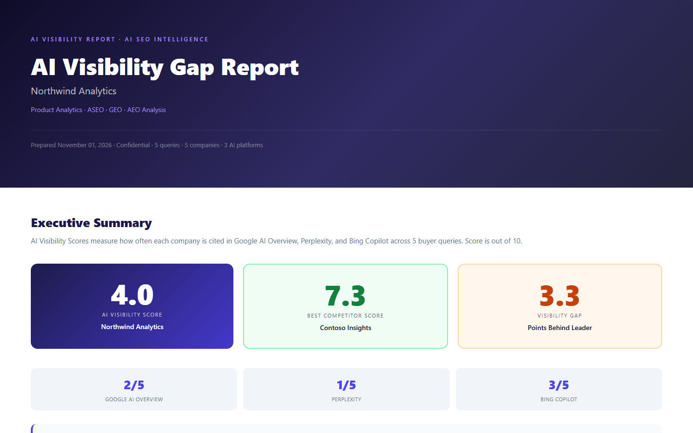

# seo-competitive-intel

Turns a company name into a client-ready report showing who gets cited by AI search engines and how far behind the company is.



*Sample report*

## Why it exists

A competitor teardown takes hours by hand. This produces the same report in one run, with a screenshot behind each finding.

## How it works

- Reads the site and finds its category, buyer queries and competitors
- Runs the queries on each platform in a real browser
- Scores each company out of 10
- Writes the gap analysis
- Outputs one shareable HTML file

## Run it

```bash
pip install -r requirements.txt
python -m playwright install chromium
python demo.py                       # sample report, no keys needed
python ci_seo.py example_input.yaml  # live run, needs ANTHROPIC_API_KEY
```

## Notes

Screenshots use made-up brands and made-up numbers. No client data is in this repo. Automated checks of search engines may break when their pages change.

## Stack

Python, Playwright, Anthropic API

Built by [Vinay Kumar](https://vinaykumar.work) with Claude Code. I set the design and rules and reviewed the output.
